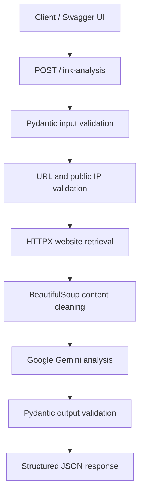

# AI-Powered Website Link Analysis API

A Python REST API that transforms a public website URL into structured business, competitor, SEO, service and target-audience insights using FastAPI and Google Gemini. Developed for the Python Practical Link Analysis assignment.

**Stack:** Python 3.11+, FastAPI, Google GenAI SDK, Pydantic, HTTPX, BeautifulSoup4, Uvicorn, Pytest.

## 1. Project overview

Businesses need to understand their online presence, identify potential competitors and improve their search visibility. This application accepts a website URL, retrieves and cleans its HTML content, and passes the extracted information to Gemini for analysis. The generated response is validated against Pydantic models before it is returned as JSON.

### Features

| Analysis section | Output |
| --- | --- |
| Competitor vs. brand | Brand overview, products and services, potential competitors, strengths, weaknesses and positioning opportunities |
| Top five search queries | Exactly five queries, suitable platforms (Google, Facebook, Instagram, LinkedIn and X), intent, business relevance and target audience |
| SEO improvements | Primary, secondary, long-tail and business keywords, recommended title, title structure, meta description and supporting content |
| Top services | Up to five services, descriptions, industries, customers, benefits and evidence labels |
| Target audience | Primary and secondary audiences, industries, business types, customer profiles, geographical focus, needs, interests and marketing segments |

Additional features include structured JSON validation, URL and network safety checks, transient LLM failure retries, configurable model selection, latency and token usage logging, and interactive Swagger documentation. Competitors are labelled as unverified AI suggestions; search volumes are not fabricated.

## 2. Architecture and execution flow



1. FastAPI accepts a JSON request containing a website URL.
2. The validation layer checks the URL scheme, destination IP addresses and port.
3. HTTPX retrieves HTML, revalidating redirect destinations; BeautifulSoup extracts the title, meta description and readable text.
4. Unnecessary markup and repeated text are removed, and the extracted text is limited to 16,000 characters.
5. Gemini receives the cleaned content and instructions to generate the five analysis sections using a structured JSON schema.
6. Pydantic validates the generated output. FastAPI returns the result and source URL.

## 3. Project structure

```text
ai-link-analysis/
├── app/
│   ├── __init__.py
│   ├── main.py                  # API endpoints
│   ├── config.py                # Environment configuration
│   ├── schemas.py               # Pydantic request and response models
│   ├── services/
│   │   ├── __init__.py
│   │   ├── website_extractor.py # HTML retrieval and text extraction
│   │   ├── llm_service.py       # Gemini integration, retries and metrics
│   │   ├── analysis_service.py  # Analysis orchestration
│   │   └── competitor_service.py # Competitor analysis instructions
│   └── utils/
│       ├── __init__.py
│       └── validators.py        # URL and SSRF safeguards
├── tests/
│   └── test_link_analysis.py
├── examples/                    # Sample request and actual response
├── screenshots/                 # Execution evidence
├── .env.example                 # Environment variable template
├── .gitignore
├── requirements.txt
├── MODEL_RESEARCH.md
└── README.md
```

## 4. Local setup (Windows / VS Code)

### Prerequisites

- Python 3.11 or 3.12
- Git
- A Google Gemini API key from [Google AI Studio](https://aistudio.google.com/apikey)
- Internet access for fetching websites and invoking Gemini

Open the project root in VS Code (**File > Open Folder**) and open a PowerShell terminal (**Terminal > New Terminal**).

### Create the virtual environment and install dependencies

```powershell
python -m venv .venv
.\.venv\Scripts\Activate.ps1
python -m pip install --upgrade pip
python -m pip install -r requirements.txt
```

If PowerShell blocks activation, run `Set-ExecutionPolicy -Scope Process -ExecutionPolicy Bypass` and try activation again.

### Configure environment variables

If `.env` does not already exist, copy the template:

```powershell
Copy-Item .env.example .env
```

Open `.env` in the project root and configure:

```dotenv
GEMINI_API_KEY=your_gemini_api_key
GEMINI_MODEL=gemini-3.5-flash-lite
# Optional: separate access token for the protected demo endpoint
# DEMO_API_KEY=your_generated_demo_access_token
```

Use the Gemini model ID available to your account and successfully tested with this application. Model availability and free-tier quotas vary. Never commit `.env`, real API credentials or demo tokens to a public repository.

### Start the server

```powershell
python -m uvicorn app.main:app --host 127.0.0.1 --port 4000 --reload
```

- Health endpoint: <http://localhost:4000/>
- Swagger UI: <http://localhost:4000/docs>
- ReDoc: <http://localhost:4000/redoc>

## 5. API documentation

| Method | Endpoint | Description |
| --- | --- | --- |
| GET | `/` | Application health check |
| POST | `/link-analysis` | Analyze a public website URL |
| GET | `/docs` | Interactive Swagger documentation |

### Request

`POST /link-analysis`

Content-Type: `application/json`

```json
{
  "url": "https://www.python.org"
}
```

Use Swagger UI: expand **POST /link-analysis**, click **Try it out**, enter the JSON and click **Execute**. If demo authentication is enabled, use **Authorize** and enter the separate demo token.

PowerShell example (local server, no demo authentication):

```powershell
$body = @{ url = "https://www.python.org" } | ConvertTo-Json
Invoke-RestMethod -Uri "http://localhost:4000/link-analysis" `
    -Method POST -ContentType "application/json" -Body $body
```

### Response structure

The following is an abbreviated schema illustration, not an executed API response. Successful requests populate the nested fields with the generated analysis; the target search queries array contains exactly five entries.

```json
{
  "success": true,
  "website": "https://www.python.org/",
  "brand": {
    "name": "Python",
    "category": "Programming and technology",
    "summary": "Illustrative brand summary"
  },
  "analysis": {
    "competitor_analysis": {},
    "target_search_queries": [],
    "seo_improvements": {},
    "top_services": [],
    "target_audience": {}
  },
  "sources": ["https://www.python.org/"]
}
```

See the OpenAPI schema at `/docs` for the full field definitions. The `examples/` directory is intended to contain a real successful request and response from application testing.

### Error handling

| HTTP status | Meaning |
| --- | --- |
| 200 | Analysis completed successfully |
| 400 | Restricted or disallowed destination URL |
| 401 | Missing or invalid demo access key, when authentication is enabled |
| 413 | Website response exceeds extraction size limit |
| 422 | Invalid input, non-HTML response, insufficient readable content or excessive redirects |
| 429 | Gemini rate limit or quota exceeded |
| 502 | Website retrieval or LLM response failure |
| 503 | Missing API configuration or Gemini temporarily unavailable |

Transient Gemini server errors are retried using bounded exponential backoff (up to four total attempts, configured initial delay of two seconds and maximum delay of 15 seconds). After retries are exhausted, the API reports the failure rather than producing a fabricated response.

## 6. LLM model selection and cost optimization

Google Gemini is the primary provider because it supports schema-constrained JSON generation, offers a development free tier where eligible and can process cleaned website content efficiently. Model selection is configurable through `GEMINI_MODEL`. The application uses the `google-genai` Python SDK.

The complete three-provider comparison, pricing assumptions, latency and accuracy evaluation methodology, benchmark results, and proposed fallback strategy are documented in [MODEL_RESEARCH.md](MODEL_RESEARCH.md).

Cost and reliability measures:

- Remove HTML markup, irrelevant elements and repeated text before LLM inference.
- Bound the extracted text and generated output size.
- Generate all five analysis sections in a single LLM call per attempt.
- Validate structured JSON with Pydantic rather than accepting arbitrary text.
- Log actual Gemini latency and token usage for benchmarking.
- Retry only configured transient server failures; distinguish rate limits from unavailable services.

Estimated API cost is calculated as `(input tokens × input price + billable output tokens × output price) / 1,000,000`, where the prices are USD per million tokens. Provider rates, free-tier allowances and model availability may change. Actual costs and accuracy should be assessed from recorded usage and manual evaluation, not assumed from model capability claims.

## 7. Testing and validation

With the virtual environment active, open a second VS Code terminal and run:

```powershell
python -m pytest -v
python -m compileall app
```

The supplied smoke tests cover the health endpoint, invalid URL handling, localhost rejection and cloud metadata address rejection. These tests do not by themselves establish live LLM accuracy or full security coverage.

### Manual API test cases

| Test URL | Expected behavior |
| --- | --- |
| `https://www.python.org` | 200 if accessible and Gemini responds |
| `https://www.shopify.com` | Website-specific e-commerce analysis |
| `https://www.kitsacitsolutions.com` | Website-specific IT services analysis if accessible |
| `https://www.microsoft.com` | Website-specific technology analysis if accessible |
| `https://www.hubspot.com` | Website-specific CRM analysis if accessible |
| `invalid-url` | 422 validation error |
| `http://127.0.0.1` | 400 restricted destination |
| `http://192.168.1.1` | 400 restricted destination |
| `http://169.254.169.254` | 400 restricted destination |

Review the five sections for factual consistency with source content. Record HTTP status, input/output token counts, LLM latency, total response time and manual quality assessment in `MODEL_RESEARCH.md`. Only report observed results.

## 8. Security and limitations

- Credentials are supplied through environment variables and excluded from version control.
- URL validation restricts retrieval to public HTTP(S) destinations on their standard ports. Resolved IP addresses are checked and the selected address is pinned for the connection; redirects are independently revalidated.
- HTTP retrieval has a timeout, a response-size limit and a redirect limit.
- Website text is treated as untrusted input; the prompt instructs the model not to follow instructions embedded in website content. This reduces but does not eliminate prompt-injection risk.
- The current extractor analyzes a single HTML page. JavaScript-only websites, login-required pages and websites blocking automated retrieval may not be supported.
- Competitor suggestions are not independently researched or verified; their strengths and weaknesses are hypotheses. Search-query suggestions are not measured search-volume rankings.
- Fewer than five services may be returned if there is insufficient website evidence. Inferred services are labelled.
- Before public deployment, enable the separate demo API key protection, configure provider quotas, and consider rate limiting, concurrency limits and isolated network egress. Automated tests are not a comprehensive security audit.

## 9. Deployment on Render

Create a Python web service from the public GitHub repository in the [Render dashboard](https://dashboard.render.com/).

| Setting | Value |
| --- | --- |
| Branch | `main` |
| Root directory | Repository root |
| Build command | `pip install -r requirements.txt` |
| Start command | `uvicorn app.main:app --host 0.0.0.0 --port $PORT` |
| Health check path | `/` |

In the Render environment configuration, set `GEMINI_API_KEY`, `GEMINI_MODEL` and, for the protected demo, `DEMO_API_KEY`. Use the locally tested model ID. Never upload the local `.env` file.

After deployment, verify both the health endpoint and a successful POST request in the hosted Swagger UI. Provide the separate demo token privately to the evaluator if authentication is enabled.

### Live demo links

- Live application: **[ADD YOUR ACTUAL RENDER URL]**
- Swagger documentation: **[ADD YOUR ACTUAL RENDER URL]/docs**
- API endpoint: **[ADD YOUR ACTUAL RENDER URL]/link-analysis** (POST)

## 10. Submission evidence

The submission should include the real sample request and successful JSON response under `examples/`, and screenshots or sanitized logs demonstrating Swagger UI, successful analysis, invalid input handling, SSRF checks, Pytest results, Gemini metrics and live deployment under `screenshots/`. Do not include secrets or unverified benchmark claims.

## 11. References

- [FastAPI](https://fastapi.tiangolo.com/)
- [Google GenAI SDK](https://github.com/googleapis/python-genai)
- [Gemini structured output](https://ai.google.dev/gemini-api/docs/structured-output)
- [Gemini API pricing](https://ai.google.dev/gemini-api/docs/pricing)
- [Gemini API rate limits](https://ai.google.dev/gemini-api/docs/rate-limits)
- [Pydantic](https://docs.pydantic.dev/)
- [HTTPX](https://www.python-httpx.org/)
- [Detailed model research](MODEL_RESEARCH.md)
